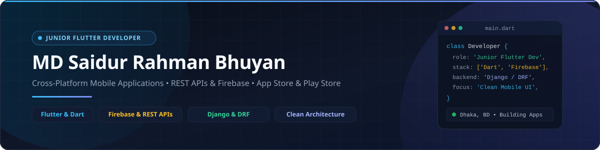

<!-- ======================================================================= -->
<!-- A. HERO SECTION                                                         -->
<!-- ======================================================================= -->

 
 

<h1>MD Saidur Rahman Bhuyan</h1>

<strong>Junior Flutter Developer</strong> &bull; Dhaka, Bangladesh

<em>Building practical, scalable and user-focused mobile applications with Flutter.</em>

  
  
  
  
  

---

<!-- ======================================================================= -->
<!-- B. ABOUT ME                                                             -->
<!-- ======================================================================= -->

## About Me

I am a **Junior Flutter Developer** based in Dhaka, Bangladesh, with **6+ months of professional experience** building and maintaining cross-platform mobile applications with **Flutter and Dart**.

- **Mobile Engineering:** Experienced in responsive UI implementation, state management, REST API integration, Firebase services, and local persistence.
- **Production & Publishing:** Hands-on experience preparing releases, versioning, and deploying applications to both the **Google Play Store** and **Apple App Store**.
- **Backend Exposure:** Working practical knowledge of **Django** and **Django REST Framework** (beginner-to-intermediate level) for building and integrating RESTful APIs and JWT-authenticated workflows.
- **Engineering Mindset:** Focused on writing clean, structured, maintainable code, collaborating effectively in product teams, and continuously improving through modern software engineering practices.

---

<!-- ======================================================================= -->
<!-- C. CURRENT WORK                                                         -->
<!-- ======================================================================= -->

## Current Work

**Junior Flutter Developer** — **SM Technology (A Betopia Group Company)**
`March 2026 – Present` &bull; Dhaka, Bangladesh

- Developing and maintaining production mobile applications using **Flutter** and **Dart** with clean, maintainable architecture.
- Integrating **REST APIs**, **Firebase** services, and real-time backend workflows.
- Managing **Google Play Store** and **Apple App Store** release preparation, versioning, and deployment pipelines.
- Working with in-app purchasing workflows, cloud-backed production environments, and cross-functional team collaboration.

---

<!-- ======================================================================= -->
<!-- D. TECH STACK                                                           -->
<!-- ======================================================================= -->

## Tech Stack

  

 

| Category | Technologies |
| :--- | :--- |
| **Mobile Development** |      |
| **State Management** |    |
| **Backend & APIs** |      |
| **Web Technologies** |     |
| **Firebase & Cloud** |      |
| **Databases & Storage** |     |
| **Architecture** |     |
| **Deployment & Monetization** |     |
| **Languages** |        |
| **Tools & Environment** |      |
| **AI & AI-Assisted Dev** |     |

---

<!-- ======================================================================= -->
<!-- E. FEATURED PROJECTS                                                    -->
<!-- ======================================================================= -->

## Featured Projects

> Selected production and portfolio mobile applications showcasing Flutter architecture, real-time features, Firebase, and backend API integration.

<table>
  <tr>
    <td width="50%" valign="top">
      <h3>EzyDash — Student Marketplace</h3>
      
<em>Production Mobile Application (Google Play &amp; App Store)</em>

      

        
        
        
        
      

      <ul>
        <li>Student-focused marketplace across <strong>6+ categories</strong> (Accommodation, Events, Services, Jobs, Marketplace, Giveaways) with filtering, real-time search, and pagination.</li>
        <li>Integrated <strong>REST APIs</strong> and <strong>Firebase</strong> (Authentication, Cloud Messaging, Analytics, Crashlytics).</li>
        <li>Real-time user-to-user chat with <strong>Socket.IO</strong>, user profiles, following, and saved listings.</li>
        <li><strong>Airtel Money &amp; MTN Mobile Money</strong> payments, QR ticketing, promo codes, and Google Maps.</li>
      </ul>
    </td>
    <td width="50%" valign="top">
      <h3>ChugChain — Social Video Platform</h3>
      
<em>Cross-Platform Social Video Sharing App</em>

      

        
        
        
        
      

      <ul>
        <li>TikTok-style interactive video feed with friend-based networking and cross-platform UI.</li>
        <li>Optimized streaming with controlled preloading, auto-looping, lazy loading, and visibility-based playback.</li>
        <li>End-to-end media pipeline: camera capture, video compression, multipart upload, and thumbnail generation.</li>
        <li>Social engagement, Firebase push notifications, <strong>In-App Purchases</strong>, subscriptions, and <strong>Google AdMob</strong>.</li>
      </ul>
    </td>
  </tr>
  <tr>
    <td width="50%" valign="top">
      <h3>PocketVault — Productivity App</h3>
      
<em>Full-Stack Offline-First Mobile Application</em>

      

        
        
        
        
        
      

      <ul>
        <li>Full-stack productivity app combining a <strong>Flutter</strong> client with a <strong>Django REST Framework</strong> backend.</li>
        <li>REST APIs secured with <strong>JWT authentication</strong> and user-scoped Django ORM persistence.</li>
        <li>Offline-first local storage powered by <strong>SQLite</strong> with synchronized backend data workflows.</li>
        <li>Structured using <strong>Clean Architecture</strong> and <strong>Provider</strong> for maintainable state management.</li>
      </ul>
    </td>
    <td width="50%" valign="top">
      <h3>TravelSnap — Social Travel Platform</h3>
      
<em>Location-Aware Social Travel Experience</em>

      

        
        
        
        
      

      <ul>
        <li>Social travel platform for sharing public and private GPS-tagged trips with a live community feed.</li>
        <li><strong>Firebase Authentication</strong>, <strong>Cloud Firestore</strong> offline caching, <strong>FCM</strong>, and ImgBB image uploads.</li>
        <li><strong>Google Maps</strong>, <strong>Geolocator</strong>, and <strong>Geocoding</strong> for automatic address resolution.</li>
        <li>Declarative routing and deep-navigation structure built with <strong>GoRouter</strong>.</li>
      </ul>
    </td>
  </tr>
</table>

---

<!-- ======================================================================= -->
<!-- F. GITHUB STATISTICS                                                    -->
<!-- ======================================================================= -->

## GitHub Statistics

  
  

 

  

---

<!-- ======================================================================= -->
<!-- G. CONTRIBUTION SNAKE ANIMATION                                         -->
<!-- Note: .github/workflows/snake.yml is configured. Once pushed and run    -->
<!-- once from GitHub Actions (creating the `output` branch), uncomment the  -->
<!-- <picture> block below to display the live contribution snake animation. -->
<!-- ======================================================================= -->

<!--
## Contribution Snake

  <picture>
    <source media="(prefers-color-scheme: dark)" srcset="https://raw.githubusercontent.com/saidur1004/saidur1004/output/github-contribution-grid-snake-dark.svg" />
    <source media="(prefers-color-scheme: light)" srcset="https://raw.githubusercontent.com/saidur1004/saidur1004/output/github-contribution-grid-snake.svg" />
    
  </picture>

-->

<!-- ======================================================================= -->
<!-- H. CURRENTLY LEARNING                                                   -->
<!-- ======================================================================= -->

## Currently Learning

- **Django & Django REST Framework** — strengthening practical backend API design, serializers, authentication, and ORM workflows.
- **Backend API Development** — designing clean, reliable endpoints to pair smoothly with Flutter mobile clients.
- **AI API Integration** — exploring practical mobile & backend workflows using Google Gemini API and Hugging Face APIs.
- **Modern Software Architecture** — deepening Clean Architecture, modular feature structuring, and testability.
- **Performance Optimization** — refining list/media rendering, network caching, and memory efficiency in Flutter apps.

---

<!-- ======================================================================= -->
<!-- I. GITHUB ACTIVITY                                                      -->
<!-- ======================================================================= -->

## GitHub Activity

  

---

<!-- ======================================================================= -->
<!-- J. CONTACT ME                                                           -->
<!-- ======================================================================= -->

## Connect With Me

  
  
  
  
  

---

<!-- ======================================================================= -->
<!-- K. FOOTER                                                               -->
<!-- ======================================================================= -->

  
<strong>Always learning, building, and improving.</strong>

  
    
  

